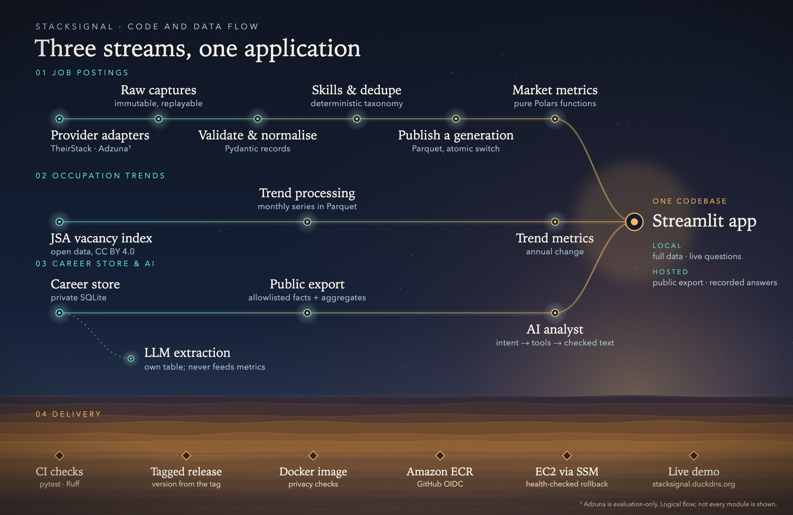

# StackSignal

### Understand what employers are looking for.

StackSignal brings Australian job advertisements together so you can explore the skills employers ask for, compare roles and understand advertised salaries—with AI explanations you can check against the underlying figures.

[**Explore the demo →**](https://stacksignal.duckdns.org) · [What I built](#what-i-built) · [Technical details](#technical-details)

## Why I built it

Job advertisements contain useful clues about what employers need, but those clues are scattered across individual listings. Comparing roles means reading many advertisements and working out which requirements appear repeatedly.

I built StackSignal to turn those scattered observations into a product people can explore: clear charts, role comparisons and AI explanations linked to the figures behind them.

## What you can do

- **Explore with an AI analyst.** Choose questions such as “How do data engineer and data analyst jobs differ?” and read an explanation with supporting charts.
- **See which skills appear most often.** Compare what employers request across roles and Australian cities.
- **Explore advertised pay and vacancies.** View available salary figures, broader occupation trends and links to selected original advertisements.

The public AI demo lets you choose from **23 questions with recorded responses**. You can also explore the figures interactively. The local version also accepts open-ended questions.

## What makes the AI useful

The AI explains the results; the application calculates the numbers. Before an explanation is shown, the application checks its numbers and references against the available results. If that check fails, it withholds the explanation and keeps the available figures visible.

The analyst can also ask for clarification, say there is not enough data, or explain that a question is outside its scope. These checks reduce some errors, but they do not guarantee that every statement is correct.

## What I built

I built the project end to end, from data collection and organisation to the AI experience and online deployment.

| Area | My contribution |
| --- | --- |
| **AI** | Built the analyst and a separate feature that extracts requirements from job advertisements; evaluated their results and costs. |
| **Software engineering** | Built the application, tested how it handles failures, and automated deployment and recovery on AWS. |
| **Data engineering** | Built the workflows that collect, clean and combine postings, calculate consistent figures and publish data safely. |

## Try it in two minutes

1. [Open the demo](https://stacksignal.duckdns.org) and select **AI Analyst**.
2. Choose a question in **Ask** to see a recorded answer and its chart.
3. Try a role comparison, then explore **Figures** or **Market overview** yourself.

**Keep the scope in mind:** the postings come from a personal search and permitted public sources, not a representative survey of Australia's job market. Missing salaries and small samples limit what can be concluded.

---

## Technical details

The sections below explain the implementation, evaluation and engineering trade-offs.

[AI workflow](#from-question-to-checked-explanation) · [Evaluation](#measured-results) · [Software engineering](#software-engineering) · [Data engineering](#data-engineering) · [Data scope](#data-scope-is-part-of-the-answer)

The diagram shows the local and hosted application boundaries. The analyst reads only the public export in both modes; local access to other data belongs to the wider application.

### From question to checked explanation

| Step | Responsibility | Inspectable evidence |
| --- | --- | --- |
| **1. Interpret** | The model proposes a structured summary or comparison; code validates roles and cities. | Intent and selected filters; clarification or unsupported outcome when appropriate. |
| **2. Compute** | Deterministic tools calculate skill shares, 95% Wilson confidence intervals, eligible salary quartiles and role overlap. | Cohort sizes, result tables, source scope and public posting references. |
| **3. Explain** | The model explains the supplied result. | Recorded call usage and timing. |
| **4. Check** | Code checks numerical support and citation references. | Numbers mapped to result fields; explanations that fail the check are withheld while available computed figures remain visible. |

The checker is a numerical and reference guard, **not a guarantee that every sentence is correct**. It can miss an incorrect claim without a number, and a supported number alone does not establish sound reasoning.

### Two AI features, separate responsibilities

**AI Analyst** explains published aggregates. Its input is the public export, even when used locally. It does not open the personal career database or receive shell, SQL or arbitrary file-access tools.

**Structured extraction** reads advertisements locally into a fixed schema: skills and requirement levels, seniority, minimum experience, work mode, work rights and salary, with evidence quotes. A skill is retained only when the deterministic matcher also finds it. Extraction results sit beside the authoritative fields; **they do not feed the published market metrics**.

### Hosted and local execution

| Experience | What runs |
| --- | --- |
| Hosted Ask tab | Replays real answers recorded locally; no question box or live model calls. |
| Hosted Figures tab | Interactive deterministic analysis of the published data; no model required. |
| Local Ask tab | Accepts questions, validates their intent, computes results, then checks the model's explanation. |

The bundled library was recorded on **20 October 2026**. Of its 23 questions, 14 received answers, 6 were outside the supported scope, 2 had insufficient data, and 1 prompted a request for clarification. These are demonstration outcomes, not an accuracy score. Each record carries its model, recording date, cost and dataset fingerprint; saved explanations are checked again before publication.

### Measured results

| Evaluation | Recorded result | How to read it |
| --- | --- | --- |
| Chosen extraction setup, 86 scored held-out advertisements | **0.938 skills F1 · 0.896 requirement-level accuracy** | Small labelled set; held-out results were inspected during development. |
| Whole-store extraction run | **$5.22 for 8,194 submissions** | Approximately $0.64 per 1,000 in batch at the measured prices; not a pricing promise. |
| Analyst held-out evaluation, 21 cases | **21/21 correct outcomes · 8/12 explanations passed** | Historical run; correct outcomes and accepted prose are different measures. |

Of the four explanations withheld during the held-out evaluation, three exposed a rounding issue in the checker, which was subsequently fixed and covered by a regression test. The remaining explanation rounded a value in a way the checker did not support. The held-out evaluation was not rerun after the fix; its original result is preserved.

The extraction evaluation used a 120-advertisement labelled set with 30 development and 90 held-out items; deduplication left 86 scored held-out items. Labels were produced through manual work and model assistance, then reviewed against the labelling rules. The small set and repeated inspection of held-out results limit how broadly these scores generalise; agreement between labellers does not establish ground truth.

### Software engineering

Data access, analytical tools, model orchestration and dashboard presentation have separate responsibilities. Pydantic contracts define structured inputs and results. Model-proposed roles and cities are validated before execution, and unavailable or unsupported results have explicit outcomes.

Offline tests cover interrupted ingestion, replay, failed publication, overlapping writers, metric boundaries and analyst checks. Quality checks include Ruff, pytest and fixture-based pipeline smoke checks. Public-export verification and Docker image checks enforce the separation between shareable data and private workspace records.

#### Deployment and recovery

Terraform defines the hosting infrastructure. GitHub Actions uses OIDC for temporary AWS credentials, publishes Docker images to ECR and deploys tagged releases through Systems Manager. Caddy provides HTTPS on a single EC2 instance.

Health checks reject an unhealthy candidate and the deployment script restores the previous container. A recorded AWS exercise on **23 September 2026** verified unhealthy-candidate recovery through Systems Manager using an isolated test container.

**Boundary:** the single instance is a single point of failure. The exercise did not establish high availability, zero downtime, GitHub Actions failure propagation or recovery from every possible failure.

**Tools:** Python · Pydantic · Streamlit · pytest · Ruff · Docker · Terraform · GitHub Actions · AWS EC2 / ECR / Systems Manager.

### Data engineering

The postings pipeline retains original captures, validates and normalises records, deduplicates them, extracts skills deterministically and publishes analytical datasets. A separate pipeline processes official occupation-demand statistics. Metric functions are independent of dashboard presentation and model explanations.

| Decision | Why it matters | Boundary |
| --- | --- | --- |
| Persist every successful ingestion page | Earlier captures survive a later request failure and can be replayed. | Exact cursor resumption against a changing provider search is not guaranteed. |
| Publish related postings datasets as one generation | An atomic pointer switch keeps readers on a consistent set; a process lock rejects overlapping writers. | Local POSIX process-failure protection, not distributed coordination or power-loss durability. |
| Define metric cohorts explicitly | Skill numerators and denominators use the same usable-description cohort; salary eligibility and missingness remain testable. | The separate occupation-trend pipeline has its own publication path. |
| Separate aggregates from public posting examples | Counts from the broader eligible sample support analysis while individual references remain restricted to allowlisted hosts. | Posting examples are only a subset of the aggregate cohort. |

**Tools:** Python · Polars · Parquet · SQLite · deterministic skill taxonomy. The batch pipeline has no cloud dependency. Local LLM extraction results remain separate and do not feed published market metrics.

### Data scope is part of the answer

The postings reflect a personal search and source restrictions, **not a representative survey of the Australian labour market**. Role categories come from job titles and may overlap.

- **Analyst aggregates:** precomputed figures over in-scope sources, excluding Adzuna. Job-board and aggregator rows are not republished as individual listings.
- **Public posting references:** allowlisted employer ATS and government hosts only. These examples are a subset of the aggregate cohort, not a complete list of contributing postings.
- **Private material:** advertisement text, raw captures, evidence quotes and personal application records stay outside the public export and deployment image.
- **Sample limits:** skill-demand answers require at least 10 usable descriptions per side. Salary percentiles require at least 10 eligible annual observations; missing salaries remain missing, and hourly or daily rates are not annualised.

Intervals describe uncertainty within the observed sample; they do not correct its selection bias.

### Sources and limitations

Adapters exist for TheirStack and Adzuna; access does not establish permission to republish or aggregate. Adzuna remains evaluation-only without the required written licence and is excluded from public analyst aggregates.

Occupation trends use the [Jobs and Skills Australia Internet Vacancy Index](https://www.jobsandskills.gov.au/data/internet-vacancy-index). © Commonwealth of Australia, [CC BY 4.0](https://creativecommons.org/licenses/by/4.0/).

This showcase presents the product, illustrations and summaries of recorded checks. Application source and operational records remain private. Production-scale throughput has not been benchmarked.

---

Built by [Ran Lu](https://github.com/ranlu302) · **StackSignal — Job Market Intelligence**
