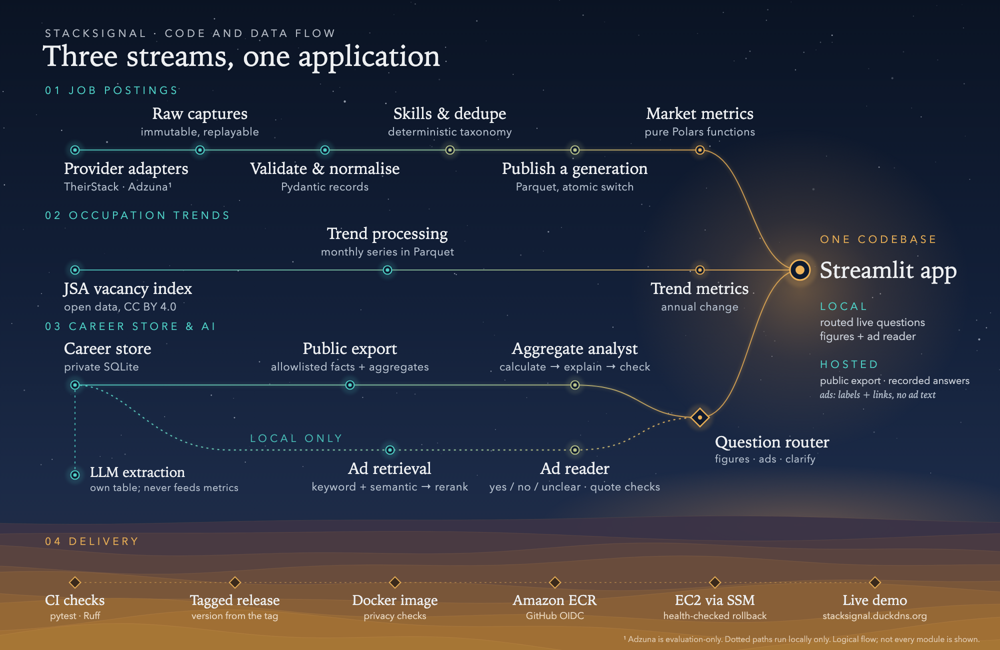

# StackSignal

### Understand what employers are looking for.

Explore the skills, salaries and requirements in Australian job advertisements, with AI answers checked against their supporting figures or source passages.

[**Explore the demo →**](https://stacksignal.duckdns.org) · [Engineering decisions](#three-engineering-decisions) · [Technical details](#technical-details)

## Why I built it

Comparing jobs means reading scattered advertisements and working out which requirements appear repeatedly. I built StackSignal to bring that information together: compare roles, explore advertised pay, and find advertisements that describe a particular requirement.

This is a personal project. I built the data pipelines, application, AI workflows and AWS deployment, and evaluated their behaviour and failure handling.

## Try it in two minutes

1. [Open the demo](https://stacksignal.duckdns.org) and select **AI Analyst**.
2. Choose “How do data engineer and data analyst jobs differ?” to see a recorded explanation with supporting figures.
3. Choose “Which roles can be done fully remotely?” to see labels and links to individual advertisements.

The current library has **eight recorded questions**. Hosted answers are recordings, with no live model calls; the **Figures** tab remains interactive. Open-ended questions and advertisement retrieval run locally.

### One question, from evidence to answer

For “Which roles can be done fully remotely?”, the local application's question router sends the question to the advertisement reader, which finds relevant advertisement passages, reorders them by relevance, and asks the model to label each advertisement **yes**, **no** or **unclear**, with a supporting quote.

Code checks that each quote occurs in its retrieved passage and that the answer's references and numbers have support. If a check fails, the answer is withheld. The public recording shows permitted labels and source links; advertisement passages and quotes stay local.

This is retrieval-augmented generation (**RAG**): the model receives relevant source material before answering. A matching quote still needs correct interpretation, and the retrieved results do not measure how common a requirement is across the market.

## What I built

- **Backend and application:** separated data access, calculations, model orchestration and presentation, with validated inputs and explicit failure outcomes.
- **Data pipelines:** captured, cleaned and deduplicated postings; calculated consistent metrics; published related datasets together so readers see a consistent version.
- **Applied AI:** built an aggregate analyst, advertisement retrieval and reading, and structured requirement extraction, with question routing that chooses between figures and advertisement evidence, asks for clarification, or declines. Evaluated quality, latency and cost.
- **Delivery:** defined AWS infrastructure with Terraform, automated tagged deployments through GitHub Actions, and exercised recovery from an unhealthy container.

**Core tools:** Python · Polars · SQLite · Pydantic · Streamlit · pytest · Docker · Terraform · GitHub Actions · AWS.

## Three engineering decisions

### Keep calculations and advertisement reading separate

A question about skill demand needs counts over a defined sample. A question about remote work needs evidence from individual advertisements. I built separate paths for these tasks: code calculates market figures, while retrieval supplies passages for the advertisement reader. Structured AI extraction stays separate from the published metrics.

That separation lets the application check an explanation against its inputs and keeps retrieved examples from being presented as market-wide statistics.

### Choose retrieval settings from measured trade-offs

I compared keyword search, semantic search, hybrid search and reranking. Reducing reranking from 50 to 20 candidates per search method cut median search time from **7.7 seconds to 0.9 seconds** on an Apple M1, with models already loaded. The relevance score stayed similar on 49 labelled queries, but fell on a separate small set of paraphrased questions. I chose the smaller setting for the local application.

These are local search timings, excluding answer generation. The evaluation is small and partly model-judged; its details and limitations are below.

### Make failed checks visible

In a 12-question advertisement evaluation, **10 answers passed the checks and two were withheld**. One failed because of an unsupported number; the other supplied a quote that was not found in its advertisement.

I built the checks to withhold these answers rather than show unsupported results. For market questions, available calculated figures remain visible even when the explanation fails. Passing the checks does not guarantee that every conclusion is correct.

## Technical details

This overview shows the main data and deployment paths. A question router sends each question to the aggregate analyst, which reads the public export, or to the advertisement reader, which runs locally over a private retrieval index (dotted).

### Architecture and technologies

**Data processing:** Python and Polars normalise and deduplicate postings, extract skills through a deterministic taxonomy, and produce Parquet datasets. Related posting datasets are published as one generation through an atomic pointer switch; a process lock rejects overlapping writers. Successful ingestion pages are saved individually so earlier captures can be replayed after a later request fails.

**Application and AI:** Streamlit presents the results, with Pydantic contracts validating structured inputs and outputs. The aggregate analyst reads only the public export. Code calculates skill shares, salary quartiles and role comparisons before the model explains them. Separate Claude API extraction produces structured requirements with evidence quotes; those results do not feed published metrics.

**Retrieval:** SQLite FTS5 provides keyword search, BGE embeddings run through ONNX, and reciprocal-rank fusion combines keyword and semantic results. A MiniLM cross-encoder reranks passages before the advertisement reader receives them. The private index stays local; no vector database service is required.

### Testing and evaluation

Offline tests cover interrupted ingestion, replay, overlapping writers, publication failures, metric boundaries and answer checks. Ruff and pytest run alongside fixture-based pipeline smoke checks. Public-export and Docker-image checks enforce the separation between shareable data and private records.

Selected measurements provide evidence, with limits:

- **Routing:** the model selected the expected route for 19 of 20 held-out questions, compared with 9 for keyword rules. This is a small evaluation.
- **Retrieval:** reducing candidates kept nDCG@10, a ranking-quality measure, similar on 49 labelled queries (0.752 to 0.753), but reduced it on 12 paraphrased queries (0.904 to 0.855). The latter set was model-judged, not owner-reviewed, and its candidate pool favoured the larger setting.
- **Extraction:** skills F1 was 0.938 on 86 scored held-out advertisements. Labels were created manually with model assistance, and held-out results were inspected during development, limiting generalisation.

These measurements concern separate components. They are not an overall accuracy score for the application.

### Deployment and scope

Terraform defines the AWS infrastructure. GitHub Actions uses OIDC for temporary credentials, publishes Docker images to ECR, and deploys tagged releases through Systems Manager. Caddy serves HTTPS on EC2. A recorded exercise on 23 September 2026 verified recovery from an unhealthy candidate container. The single instance remains a single point of failure; high availability and production-scale throughput have not been established.

Postings reflect a personal search and permitted sources, not a representative survey of Australia's labour market. Small samples and missing salaries constrain conclusions; hourly and daily rates are not annualised. Public listing references are restricted to allowlisted employer ATS and government hosts. Advertisement text, quotes and personal application records stay outside the public export and deployment image. Adzuna remains evaluation-only and is excluded from public analyst aggregates.

Occupation trends use the [Jobs and Skills Australia Internet Vacancy Index](https://www.jobsandskills.gov.au/data/internet-vacancy-index). © Commonwealth of Australia, [CC BY 4.0](https://creativecommons.org/licenses/by/4.0/).

---

Built by [Ran Lu](https://github.com/ranlu302) · **StackSignal — Job Market Intelligence**
